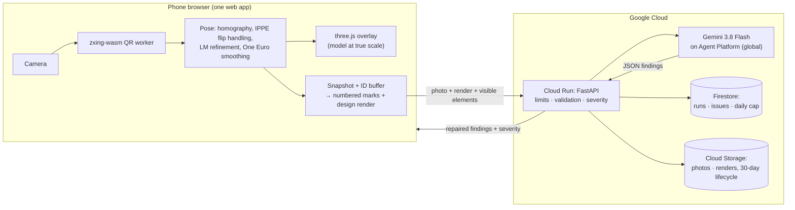

<p align="center"></p>

**Point a phone at a QR code on site and the BIM model appears over the real room at true scale. Tap *Check as-built*: Gemini compares the photo with the design, the deviations are pinned on the model, and the issue is drafted.**

Google Cloud AI Builder Cup 2026 (JAPAC) · Theme: **Future of Work & Enterprise Productivity** · Team: Wai and Michael (Aung Nyein Chan)

**Live demo:** _link added at deployment_ · nothing to install: it runs in the phone's browser.

---

## Try it in 60 seconds (no printer, no site)

1. Open **Samples** and tap a photo. TrueSite runs the real as-built check on a photo taken in our demo room, using the camera pose stored with it.
2. Read the findings. Each one has an evidence box on the photo, a rough offset ("about 30 cm right"), and a severity set by TrueSite from the element type.
3. Tap **Draft issue** on a deviation. Gemini drafts it, you edit it, and you save it. It then appears under **Issues**.
4. Tap **See the pins on the 3D model**, then tap any element and **Ask** a question ("What's the fire rating?"). Answers come only from that element's model data, and the fields used are shown.
5. *With a printer:* print the A4 desk sheet (`bim/sheets/room1-D1.pdf`, at 100%) and open `/a/room1/D1` on your phone. The room appears on your desk at 1:20.

> The deviations in our demo room are staged on purpose (the design differs from the room in a few places), so there is something real to find. Findings are labelled **"Visual check, not a survey."**

## Why

Field engineers make build decisions without the model in front of them, and mistakes surface as rework weeks later. TrueSite puts the BIM model and a second pair of eyes where the work happens: open a link, scan a code, check.

## How it works



1. **Anchor.** Each printed QR code carries a deep link (`/a/<project>/<anchor>`). The code's position, orientation and scale in the model are surveyed once (`anchors.json`).
2. **Pose.** The browser finds the code's four corners every frame and solves the camera pose:
   - planar homography, then IPPE with the previous frame as a prior against the "flip" ambiguity
   - Levenberg–Marquardt refinement
   - One Euro smoothing
   - Optional 10-second self-calibration of the focal length.
3. **Overlay.** The model is drawn at true scale (1:1 on a wall code, 1:20 on a desk code), with an alignment badge and distance.
4. **As-built check.** From the snapshot pose, the browser renders an ID buffer to find the visible elements, then a design render with numbered marks. Gemini compares that render with the photo and returns JSON.
5. **Server rules.** The server repairs the answer: one finding per mark, clamped boxes, low confidence becomes "can't judge", and offsets are rounded to 10 cm. **Severity comes from the element class in code**, never from the model.
6. **Act.** Findings are pinned in 3D. Questions are answered from the element's own properties, with the fields cited. Issues are drafted by Gemini and saved by a person.

**Google Cloud:**
- **Cloud Run** (`asia-southeast1`): API plus web app on one origin.
- **Gemini 3.8 Flash on Gemini Enterprise Agent Platform** (`global`): structured JSON output, low thinking, high media resolution.
- **Firestore**: check runs, issues, and an atomic daily cap counter.
- **Cloud Storage**: photos and renders, with a 30-day lifecycle.
- **Cloud Build / Artifact Registry**: source deploys.
- **Secret Manager**: only for the API-key fallback.
- **Budget alerts.**

## Safety, honesty and cost

- **Visual check, not a survey.**
  - Offsets are given in tens of centimetres, never millimetres.
  - Unsure judgements are shown as "Can't judge from this photo".
  - Everything Gemini writes is a draft for a person.
- **The photo is untrusted input.** Gemini has no tools and no write access. Its output is schema-checked, element references must match the request, and severity is computed by code. Text visible in the photo is treated as scenery.
- **No accounts.** Each browser gets a random session id; checks, photos and issues are visible only to that session. Seeded examples are read-only.
- **Limits:**
  - 10 checks per IP per hour
  - a global daily cap
  - 4 MB uploads
  - at most 2 Cloud Run instances
  - Each check costs about 1–2 US cents at the introductory price.

## Accuracy

| What | Result |
|---|---|
| Pose, **simulation** (1280×720, 0.5 px corner noise, 23–25 cm code at 0.5–3 m) | median 3.6 mm translation, 0.66° rotation |
| Self-calibration, **simulation** (30 tilted views) | focal length within 1% |
| Overlay error on a real phone at 1, 2, 3 m | _measured on device, reported here before submission_ |
| As-built check on labelled photos (hits / misses / false alarms) | _measured, reported here before submission_ |

Simulation numbers are not field accuracy. We publish what we measure.

## Run it locally

Requirements: Node 20.19+, Python 3.13 with [uv](https://docs.astral.sh/uv/), Docker (optional).

```bash
make dev-server   # API on :8000 with an offline Gemini stand-in and an in-memory store
make dev-web      # web app on :5173 (proxies /api); phones: cd web && npm run dev:https
make test         # BIM (54) + server (260) + web (149) tests and the TypeScript build
```

Deploy to Google Cloud with `make setup`, `make deploy` and `make verify` (see `infra/gcloud.sh`). Rebuild the model after replacing `bim/models/room1/model.ifc` with `make models`.

## Repository

| Path | What |
|---|---|
| `web/` | Vite + React + three.js app: pose maths (`src/pose`), QR worker, AR overlay, check pipeline, UI |
| `server/` | FastAPI on Cloud Run: Gemini client, validation, severity, limits, Firestore and Cloud Storage store |
| `bim/` | Offline pipeline: IFC → glb with element GUIDs, `elements.json`, printable QR sheets (ifcopenshell) |
| `docs/` | [Design spec](docs/specs/2026-10-11-truesite-design.md), [interface contract](docs/plans/2026-10-11-truesite-contract.md), [research notes](docs/research/research-notes.md), [submission checklist](docs/submission-checklist.md) |

## Freshness

Built from scratch during the hackathon. The repository was started on 11 Oct 2026, and every commit is dated. It contains no code, assets, prompts or data from earlier projects. The demo model, the photos and the brand were all made during the event.
