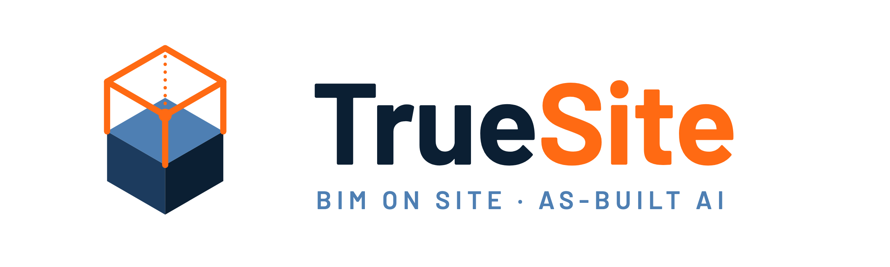
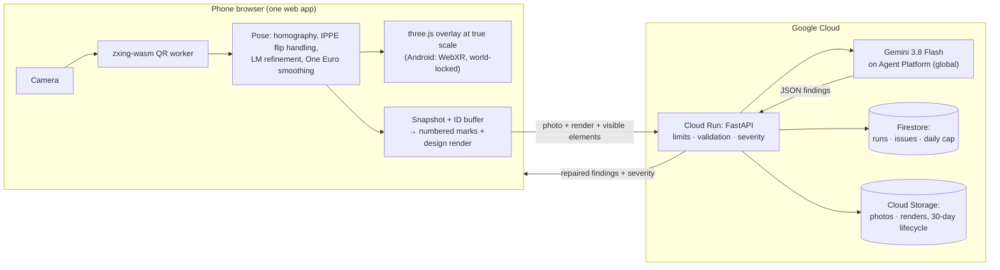

<p align="center"></p>

**Point a phone at a QR code on site and the BIM model appears over the real room at true scale. Tap *Check as-built*: Gemini compares the photo with the design, the deviations are pinned on the model, and the issue is drafted.**

Google Cloud AI Builder Cup 2026 (JAPAC) · Theme: **Future of Work & Enterprise Productivity** · Team: Wai Lin and Aung Nyein Chan (Michael)

**Live demo:** _link added at deployment_ · nothing to install: it runs in the phone's browser.

---

## Try it in 60 seconds (no printer, no site)

1. Open the live demo. On the start page, tap **Try the as-built check**. You stand on a QR spot inside a **simulated as-built site**: a realistic 3D model of the building as it was put up, with ten defects planted on purpose (`web/src/sim/asBuilt.ts`). Look around (drag, or turn the iPad), then tap **Check as-built**: TrueSite takes your view as the site photo, renders the BIM design from the same spot, and Gemini compares the two. The result lists what was planted, so you can compare. Four still photos of the same site are there too (`web/scripts/make-samples.mjs`).
2. Read the findings. Each one has an evidence box on the photo, a rough offset ("about 30 cm right"), and a severity set by TrueSite from the element type.
3. Tap **Draft issue** on a deviation. Gemini drafts it, you edit it, and you save it. It then appears under **Issues**.
4. Tap **See the pins on the 3D model**, then tap any element and **Ask** a question ("What's the fire rating?"). Answers come only from that element's model data, and the fields used are shown.
5. *With a printer:* on the start page, tap **Download A4 desk sheet**, print it at 100% and scan the code with your phone camera. The room appears on your desk at 1:20. **Download A4 floor sheet** does the same at 1:1: lay it on the floor and the room stands around you.

> The deviations in our demo room are staged on purpose (the design differs from the room in a few places), so there is something real to find. Findings are labelled **"Visual check, not a survey."**

## Why

Field engineers make build decisions without the model in front of them, and mistakes surface as rework weeks later. TrueSite puts the BIM model and a second pair of eyes where the work happens: open a link, scan a code, check.

## How it works



1. **Anchor.** Each printed QR code carries a deep link (`/a/<project>/<anchor>`). The code's position, orientation and scale in the model are surveyed once (`anchors.json`).
2. **Pose.** The browser finds the code's four corners every frame and solves the camera pose:
   - planar homography, then IPPE with the previous frame as a prior against the "flip" ambiguity
   - Levenberg–Marquardt refinement
   - One Euro smoothing
   - Optional 10-second self-calibration of the focal length.
3. **Overlay.** The model is drawn at true scale (1:1 on a floor or wall code, 1:20 on a desk code), with an alignment badge and distance. See [AR modes](#ar-modes).
4. **As-built check.** From the snapshot pose, the browser renders an ID buffer to find the visible elements, then a design render with numbered marks. Gemini compares that render with the photo and returns JSON.
5. **Server rules.** The server repairs the answer: one finding per mark, clamped boxes, low confidence becomes "can't judge", and offsets are rounded to 10 cm. **Severity comes from the element class in code**, never from the model.
6. **Act.** Findings are pinned in 3D. Questions are answered from the element's own properties, with the fields cited. Issues are drafted by Gemini and saved by a person.

**Google Cloud:**
- **Cloud Run** (`asia-southeast1`): API plus web app on one origin.
- **Gemini 3.8 Flash on Gemini Enterprise Agent Platform** (`global`): structured JSON output, low thinking, high media resolution.
- **Firestore**: check runs, issues, and an atomic daily cap counter.
- **Cloud Storage**: photos and renders, with a 30-day lifecycle.
- **Cloud Build / Artifact Registry**: source deploys.
- **Secret Manager**: only for the API-key fallback.
- **Budget alerts.**

## AR modes

Scanning a code opens its live view. Which buttons you get depends on the phone:

| Mode | Phones | What happens |
|---|---|---|
| **Start AR (place by code)** | Android Chrome (ARCore) | A WebXR session sends the camera frames to the same QR worker and pose maths. Move slowly left and right until the ring fills: estimates from many angles are fused, then the model is **world-locked**. You can look away from the code, walk under the model and look up. |
| **Camera overlay** (iPhone: **Start camera**) | Every phone | The model follows the code while it is in view. **Look-around**: when you turn on the spot, the gyroscope holds the model in place. |
| **Walk inside (AR)** | Android, iPhone, iPad | The model at 1:1 in the phone's own world tracking. Android uses a WebXR floor hit-test. iPhone and iPad open AR Quick Look with a USDZ built from the model. On a 1:1 floor code this is the **main button on iPhone/iPad**. |

In the live view, **Transparency**, **Cut above** (a section height), **View distance** and **Layers** (structure, rebar, doors/windows/services, other) keep the model readable over a real place. Elements are **colour-coded by type** in the viewer, every AR mode and Quick Look: columns blue, beams cyan, truss members green, purlins yellow, bracing purple, concrete see-through grey, rebar orange-red.

**iPad building site (project `site`).** Set the four upright A3 sheets P1–P4 out on a car park with `site-layout.pdf`, stand on each X, lock close to the code, step back and turn on the spot. The camera overlay levels the model with the motion sensors. The full filming checklist is in [docs/demo/ipad-ar-filming.md](docs/demo/ipad-ar-filming.md). Walk inside (Quick Look / WebXR) and Android Start AR are hidden for the demo; add `?xr=1` to the page URL to bring them back.

**Device status (15 Oct):** On Android over the LAN we have tested the desk overlay, the QR scan and the live *Check as-built*. Not yet confirmed on a device: the place-by-code session, the iPhone Quick Look walk-in, and look-around on iPhone.

## Projects and sheets

| Project | Model | Sheets |
|---|---|---|
| `room1` | The 4 × 3 m demo room with its staged deviations | **D1** A4 desk sheet (1:20), **D2** A3 sheet for the 1:20 physical model, **L1** A4 floor sheet (1:1), **A1** A3 wall sheet (1:1, at the surveyed spot) |
| `rooftop` | A 9 × 9 m two-storey concrete frame (32 columns, 48 beams, 80 rebar cages with starter bars), generated by `bim/truesite_bim/rooftop.py` | **R1** A2 floor sheet with a 33 cm code (the hero demo), **R2** A4 version, **V1–V3** upright A4 viewpoints for tablets without world tracking |
| `site` | A two-storey building under construction, 18 × 12 m on 6 m bays: RC ground storey (columns with visible cages, beams, slab cast over two bays, rebar mat in the third, edge protection), steel upper storey to 8.5 m eaves, trusses to about 10.5 m, purlins, bracing; 191 elements, nothing below the ground. Generated by `bim/truesite_bim/site.py` | **P1–P4** upright A3 viewpoints (code centre 1.4 m, stand 1.5 m in front), **D1** A4 desk sheet (1:100), plus `site-layout.pdf` for setting out |

Open the rooftop frame in the viewer at `/model?project=rooftop` and the building site at `/model?project=site`. The start page offers the site layout plan, P1–P4 and D1 for download. Every sheet is rendered for the deployed URL (see [Deploy](#deploy)).

## Safety, honesty and cost

- **Visual check, not a survey.**
  - Offsets are given in tens of centimetres, never millimetres.
  - Unsure judgements are shown as "Can't judge from this photo".
  - Everything Gemini writes is a draft for a person.
- **The photo is untrusted input.** Gemini has no tools and no write access. Its output is schema-checked, element references must match the request, and severity is computed by code. Text visible in the photo is treated as scenery.
- **No accounts.** Each browser gets a random session id; checks, photos and issues are visible only to that session. Seeded examples are read-only.
- **Limits:**
  - 10 checks per IP per hour
  - a global daily cap
  - 4 MB uploads
  - at most 2 Cloud Run instances
  - Each check costs about 1–2 US cents at the introductory price.

## Accuracy

| What | Result |
|---|---|
| Pose, **simulation** (1280×720, 0.5 px corner noise, 23–25 cm code at 0.5–3 m) | median 3.6 mm translation, 0.66° rotation |
| Self-calibration, **simulation** (30 tilted views) | focal length within 1% |
| Overlay error on a real phone at 1, 2, 3 m | _measured on device, reported here before submission_ |
| As-built check on labelled photos (hits / misses / false alarms) | _measured, reported here before submission_ |

Simulation numbers are not field accuracy. We publish what we measure ([how](eval/README.md)).

## Run it locally

Requirements: Node 20.19+, Python 3.13 with [uv](https://docs.astral.sh/uv/), Docker (optional).

```bash
make dev-server   # API on :8000 with an offline Gemini stand-in and an in-memory store
make dev-web      # web app on :5173 (proxies /api); phones: cd web && npm run dev:https
make test         # BIM, server and web tests, plus the TypeScript build
make sheets BASE_URL=https://<laptop-ip>:5173   # printable sheets for phone tests on the LAN
```

Rebuild the room model after replacing `bim/models/room1/model.ifc` with `make models`.

## Deploy

On Google Cloud, in this order (see `infra/gcloud.sh`):

1. `make setup`, once: APIs, a least-privilege service account, Firestore, the upload bucket, and the budget alert. It is safe to run again.
2. `make deploy`: renders every QR sheet for the service URL, refuses to deploy unless each sheet links to it, then builds the container on Cloud Build and deploys it to Cloud Run. `GEMINI_BACKEND=apikey make deploy` uses an AI Studio key from Secret Manager instead of Agent Platform.
3. `make verify`: fails unless `/api/health` reports `"gemini_mode": "live"` and `"store_backend": "gcp"`, the sheets are served as PDFs that link to the URL, and one Ask round trip works.

## Repository

| Path | What |
|---|---|
| `web/` | Vite + React + three.js app: pose maths (`src/pose`), QR worker, AR modes (`src/scene`), check pipeline, UI |
| `server/` | FastAPI on Cloud Run: Gemini client, validation, severity, limits, Firestore and Cloud Storage store |
| `bim/` | Offline pipeline: IFC → glb with element GUIDs, `elements.json`, the rooftop frame, printable QR sheets (ifcopenshell) |
| `eval/` | Overlay-accuracy and check-quality measurements, and the script that turns them into the tables above |
| `infra/` | `gcloud.sh`: setup, deploy and verify on Google Cloud |
| `docs/` | [Design spec](docs/specs/2026-10-11-truesite-design.md), [interface contract](docs/plans/2026-10-11-truesite-contract.md), [research notes](docs/research/research-notes.md), [submission checklist](docs/submission-checklist.md) |

## Freshness

Built from scratch during the hackathon. The repository was started on 11 Oct 2026, and every commit is dated. It contains no code, assets, prompts or data from earlier projects. The demo model, the photos and the brand were all made during the event.
