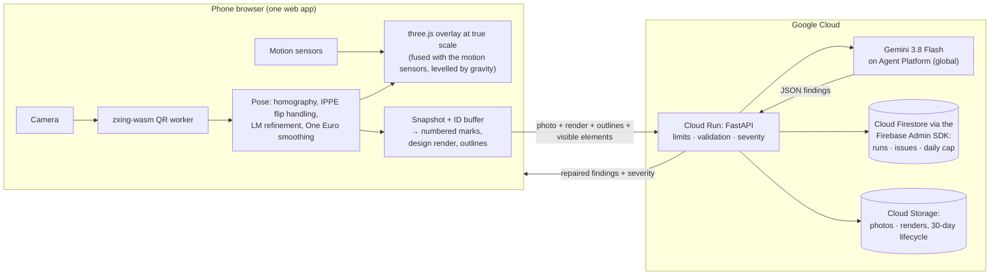

<p align="center"></p>

**Point a phone at a QR code on site and the BIM model appears over the real site at true scale. Tap *Check as-built*: Gemini compares the photo with the design, the deviations are pinned on the model, and the issue is drafted.**

Google Cloud AI Builder Cup 2026 (JAPAC) · Theme: **Future of Work & Enterprise Productivity** · Team: Wai Lin (Leon, team lead) and Aung Nyein Chan (Lin-Chiang Lee, Michael)

**Live demo:** [truesite-1067044308557.asia-southeast1.run.app](https://truesite-1067044308557.asia-southeast1.run.app) · nothing to install: it runs in the phone's browser.

**Demo video (3:15):** [YouTube](https://youtu.be/M8zh02kMtk4) · also [on the start page](https://truesite-1067044308557.asia-southeast1.run.app/#demo) ([MP4](web/public/media/truesite-demo.mp4)) · **Deck:** [TrueSite-deck.pdf](docs/TrueSite-deck.pdf) (also a download on the start page)

---

## Try it in a few minutes (no printer, no site)

1. Open the live demo. On the start page, tap **Try the virtual demo**, then pick a QR spot, P1 to P4 ("Step in at P1"). You stand on that spot inside a **simulated as-built site**: a realistic 3D model of the building as it was put up, with ten defects planted on purpose (`web/src/sim/asBuilt.ts`). Look around (drag, or turn your phone), then tap **Check as-built**. TrueSite takes your view as the site photo and sends Gemini three images: your view, the BIM design rendered from the same spot with numbered marks, and your view with each marked element's design outline. The result scores Gemini against what was planted in that view, so you can see what it caught and what it missed.
2. Read the findings. Each one has an evidence box on the photo, a rough offset ("about 30 cm right"), a severity set by TrueSite from the element type, and a "Why it matters" note from fixed rules, not from the model.
3. Tap **Draft issue** on a deviation. Gemini drafts it, in the crew's language if you pick one. You edit it and tap **Save issue**: it is saved with its check and finding, listed under the results, and **Copy issue** puts it on the clipboard for your issue tracker. After a check, **Write today's site report** has Gemini summarise this visit's checks, safety first.
4. Back on the start page, tap **Open the 3D model**. The last check's findings are pinned on it. Tap any element and **Ask Gemini** a question ("What concrete grade is this beam?"). Answers come only from that element's model data, and the fields used are shown.

*With a printer:* in Live AR, under **On your desk · 1:100**, tap **Download the desk sheet**, print it on US Letter at 100% and scan the code with your phone's camera. The building stands on the page as a 1:100 model. For life size on a car park, **Download the layout plan** sets out the four sheets P1–P4 ([filming guide](docs/demo/ipad-ar-filming.md)). Opened on a laptop, a live AR page shows a popup with a QR code of the page for your phone, and the sheet to print.


> The site's defects are planted on purpose (`web/src/sim/asBuilt.ts`), so there is something to find. The building doesn't exist yet, so every view of it is a simulated render of our own model, not a photo of a real site. That covers the virtual site and the four still photos at `/samples?photos` (`web/scripts/make-samples.mjs`, each labelled "Simulated photo"). Findings are labelled **"Visual check, not a survey."**

## Why

Field engineers make build decisions without the model in front of them, and mistakes surface as rework weeks later. In a survey of nearly 600 construction leaders, project team members lost more than 14 hours a week to hunting for project data, resolving conflicts and rework. Miscommunication and poor project data caused 48% of all rework on US jobsites ([FMI and PlanGrid, 2018](https://www.phcppros.com/articles/7960-research-identifies-factors-costing-construction-industry-177-billion-annually)). TrueSite puts the BIM model and a second pair of eyes where the work happens: scan a code, see the model, check the build.

## How it works



1. **Anchor.** Each printed QR code carries a deep link (`/a/<project>/<anchor>`). The code's position, orientation and scale in the model are set once (`anchors.json`); the site's four sheets are set out on the ground from a layout plan.
2. **Pose.** The browser finds the code's four corners every frame and solves the camera pose:
   - planar homography, then IPPE with the previous frame as a prior against the "flip" ambiguity
   - Levenberg–Marquardt refinement
   - One Euro smoothing
   - optional 10-second self-calibration of the focal length
   - with the motion sensors on, sensor fusion (`web/src/scene/fusion.ts`): the code's orientation in the world is averaged over many views, and every frame is posed from it and the device rotation at that frame, so the model holds still instead of shaking with the QR noise.
3. **Overlay.** The model is drawn at true scale: 1:1 on the upright site sheets P1–P4, and at the sheet's own scale on a desk code (1:100 on the site's D1). It is levelled by gravity (`web/src/scene/level.ts`) and shows an alignment badge and the distance. See [AR modes](#ar-modes).
4. **As-built check.** From the snapshot pose, the browser renders an ID buffer to find the visible elements and numbers up to 25 of them, structure and guardrails first. Gemini gets the photo, a design render with the numbered marks, and the photo with a thin ring just outside each marked element's design position (`web/src/check/outlines.ts`). It judges each element at its own outline and returns JSON.
5. **Server rules.** The server repairs the answer: one finding per mark, clamped boxes, low confidence becomes "can't judge", and offsets are rounded to 10 cm. **Severity comes from the element class in code** (structure, rebar and guardrails rate high), never from the model.
6. **Act.** Findings are pinned in 3D. Questions are answered from the element's own properties, with the fields cited. Issues are drafted by Gemini, in the crew's language if you pick one (eight languages), and saved by a person. Gemini also drafts a site report from the checks, safety first.

**Google Cloud:**
- **Cloud Run** (`asia-southeast1`): API plus web app on one origin.
- **Gemini 3.8 Flash on Gemini Enterprise Agent Platform** (`global`): structured JSON output, low thinking, high media resolution. When it is busy (429 or 503) or a check hangs (504 or a timeout), the server tries Gemini 3.5 Flash, then 3.5 Flash-Lite, inside a 105-second budget per check.
- **Cloud Firestore, through the Firebase Admin SDK**: check runs, issues, and an atomic daily cap counter.
- **Cloud Storage**: photos and renders, with a 30-day lifecycle.
- **Cloud Build / Artifact Registry**: source deploys.
- **Secret Manager**: only for the API-key fallback.
- **Budget alerts.**

## AR modes

Scanning a code opens its live view. The demo has one mode on every phone and tablet, the camera overlay (**Start camera**). The other two stay in the code and appear only with `?xr=1` on the page URL; the printed codes don't carry it.

| Mode | Devices | What happens |
|---|---|---|
| **Camera overlay** (**Start camera**) | Every phone and tablet | The model locks on the code. With the motion sensors on, it holds still in the world and turns with the device, and it is levelled by gravity (corrections up to 8°). **Look-around:** when the code leaves the view, the sensors hold the model (turning only, not walking) for up to 90 s; point back at the code to re-align. |
| **Start AR (place by code)**, `?xr=1` only | Android Chrome (ARCore) | A WebXR session sends the camera frames to the same QR worker and pose maths. Move slowly left and right until the ring fills: estimates from many angles are fused, then the model is world-locked on the ground. Not yet tested on a device. |
| **Walk inside (AR)**, `?xr=1` only | Android, iPhone, iPad | The model at 1:1 in the device's own world tracking. Android uses a WebXR floor hit-test. iPhone and iPad open AR Quick Look with a USDZ built from the model at build time (`web/scripts/make-usdz.mjs`). Not yet tested on a device. |

While the camera runs, the view is full screen with an Exit button. **Transparency**, **Cut above** (a section height), **View distance** and **Layers** (structure, rebar, doors/windows/services, other) keep the model readable over a real place. Elements are **colour-coded by type** in the viewer, every AR mode and Quick Look: columns blue, beams cyan, truss members green, purlins yellow, bracing purple, concrete see-through grey, rebar orange-red. On the site sheets *Check as-built* is off, because nothing is built there yet; the live view points to the virtual demo instead.

**Building site (project `site`).** Set the four upright US Letter sheets P1–P4 out on a car park with `site-layout.pdf`, stand on each X, lock close to the code, step back and turn on the spot. The camera overlay levels the model with the motion sensors. The full filming checklist is in [docs/demo/ipad-ar-filming.md](docs/demo/ipad-ar-filming.md). Walk inside (Quick Look / WebXR) and Android Start AR are hidden for the demo; add `?xr=1` to the page URL to bring them back.

**Device status (18 Oct):** On 17 Oct we field-tested live AR on an iPhone against the deployed service: the building at life size on a field, with the site sheets on posts, and at 1:100 on the desk sheet D1. Scanning with the camera app, calibration, the lock, looking around and up on the motion sensors, tapping elements for their details and Ask Gemini all worked. An iPad in the same test held the model less steadily while turning: iPadOS Safari measures the screen angle from landscape while the motion sensors report in portrait, so the sensor rotation was mapped 90° off. That was fixed on 18 Oct (#1), and the end-to-end suite now replays iPad Safari's angles; the fix is not yet re-tested on the iPad itself. On Android over the LAN (15 Oct) we tested the desk overlay, the QR scan and a live *Check as-built*. Live Gemini checks run in the virtual demo on the deployed service. Not yet tested on a device: the two `?xr=1` modes.

## Projects and sheets

| Project | Model | Sheets |
|---|---|---|
| `site` (the start page) | A two-storey building under construction, 18 × 12 m on 6 m bays: RC ground storey (columns with visible cages, beams, slab cast over two bays, rebar mat in the third, edge protection), steel upper storey to 8.5 m eaves, trusses to about 10.5 m, purlins, bracing; 191 elements, nothing below the ground. Generated by `bim/truesite_bim/site.py` | **P1–P4** upright viewpoints (16 cm codes, centre 1.4 m above the ground, stand 1.5 m in front), **D1** desk sheet (62 mm code, 1:100), plus `site-layout.pdf` for setting out; all US Letter |

`site` is the only project: the start page offers its layout plan, P1–P4 and D1 to download, and the virtual demo. Every sheet is rendered for the deployed URL (see [Deploy](#deploy)).

## Safety, honesty and cost

- **Visual check, not a survey.**
  - Offsets are given in tens of centimetres, never millimetres.
  - Unsure judgements are shown as "Can't judge from this photo".
  - Everything Gemini writes is a draft for a person.
- **The photo is untrusted input.** Gemini has no tools and no write access. Its output is schema-checked, element references must match the request, and severity is computed by code. Text visible in the photo is treated as scenery.
- **No accounts.** Each browser gets a random session id; checks, photos and issues are visible only to that session.
- **Limits** on the deployed service:
  - 30 checks per IP per hour on each Cloud Run instance (judges share office IPs) and 300 a day across all users
  - questions, issue drafts and site reports share a daily budget of 300
  - 4 MB per uploaded image
  - at most 2 Cloud Run instances
- **Cost:** a check costs about US$0.015 (about 6,900 input and 2,600 output tokens, from the usage logged on the deployed service).

## Accuracy

| What | Result |
|---|---|
| Pose, **simulation** (1280×720, 0.5 px corner noise, a 25 cm code at 0.5–3 m) | median 3.6 mm translation, 0.66° rotation |
| Self-calibration, **simulation** (30 tilted views) | focal length within 1% |
| Steadiness on a stand, **ray-traced test videos** (`web/e2e/tests/live-ar-stability.e2e.ts`) | under 0.6 px a frame with the motion sensors in every case (0.02–0.58 px measured), down from 1–44 px before the steadiness fixes of 17 Oct |
| Virtual demo check at P1 on the deployed service (the run in the demo video) | found 2 of the 5 planted defects in view, no false alarms |
| Overlay error on a real phone or tablet at 1, 2, 3 m | **Not measured on a device yet** (`eval/overlay.csv` has no rows) |
| As-built check, **simulated**: the virtual demo's simulated as-built at P1–P4 with live Gemini 3.8 Flash, 16 planted defects in view across the four spots | Found 12, 11 and 7 of 16, with 5, 8 and 0 false alarms, in three runs (the third on the deployed service): about 10 found and 4 false alarms on average. It finds elements not built and a column 60 cm off sideways; it misses a 60 cm shift towards or away from the camera, and thin far members. Runs vary a lot. |

Simulation numbers are not field accuracy, and no real site photos have been scored yet: the four ready-made photos are simulated too and not yet labelled (`eval/labels.json` is empty). We publish what we measure ([how, and the full check table](eval/README.md)).

## Run it locally

Requirements: Node 20.19+, Python 3.13 with [uv](https://docs.astral.sh/uv/), Docker (optional).

```bash
(cd web && npm ci)   # once: the web app's packages (make dev-web and make test need them)
make dev-server      # terminal 1: API on :8000 with an offline Gemini stand-in and an in-memory store
make dev-web         # terminal 2: web app on :5173 (proxies /api); phones: cd web && npm run dev:https
make test            # BIM, server and web tests, plus the TypeScript build
make sheets BASE_URL=https://<laptop-ip>:5173   # printable sheets for phone tests on the LAN
```

Rebuild the site model from `bim/truesite_bim/site.py` with `make models`.

## Testing

| Suite | Command | Result (18 Oct) |
|---|---|---|
| BIM pipeline (pytest) | `cd bim && uv run pytest -q` | 88 passed |
| Server (pytest, Gemini mocked) | `cd server && uv run pytest -q` | 529 passed, 9 skipped (they need the Firestore emulator) |
| Web (vitest) and types | `cd web && npx vitest run && npx tsc -b` | 549 passed; `tsc -b` clean |
| End to end (Playwright) | in `web/e2e`, below | 164 passed, 4 skipped (desktop, iPad, iPhone, limits, live AR) |

`make test` runs the first three. No suite calls live Gemini.

**End to end.** The Playwright suite in `web/e2e/` has its own `package.json`, so it isn't part of `make test` or the image. It drives the built app on the real FastAPI server with the offline Gemini stand-in and an in-memory store, in Chromium as a laptop, an iPad Pro 11 and an iPhone 15. It covers the start page, the laptop popup, the virtual demo (the three images in the upload, every planted defect marked, a draft and a report in Thai), the ready-made views, the 3D viewer, real 429s from a server with tight limits, axe-core WCAG 2.2 A/AA checks, tap targets and CSP reports. A `live-ar` project plays ray-traced camera videos with exact ground truth into the live view: in the 18 Oct run the overlay sat 6–9 px from the truth at P1–P4 and 2 px at D1, on a 1194 × 772 px view (the test allows 10 px, about half a degree). Each of the 13 bugs the suite found has a test that asserts the fixed behaviour (`web/e2e/support/bugs.ts`): 12 are fixed, and one, Tab leaving the usage-limit popup, is still a `test.fixme`. It is Chromium, not Safari: Quick Look and the iOS motion prompt still need a device.

```bash
(cd bim && uv run python -m truesite_bim.site --sheets-only --base-url https://127.0.0.1:8813 --sheets-dir ../web/public/sheets)
(cd web && npm ci && npm run build)
cd web/e2e && npm ci && npx playwright install chromium
npx playwright test        # starts the servers itself; the 4 skipped are 3 handheld-only tests and 1 known-bug fixme
```

The live AR videos (about 1.7 GB, git-ignored) are made once with `web/e2e/scripts/live-ar-videos.py`; without them that project is left out. [web/e2e/README.md](web/e2e/README.md) has the details.

**Mutation, property and fuzz testing (17 Oct):**
- **StrykerJS** on the web app's logic, with 117 new tests: four key modules (Why it matters, the scorecard, the live-view helpers and pose quality) went from a mutation score of 83.8% to 97.5%. The survivors left look equivalent.
- **cosmic-ray** on `server/app/validate.py` and `server/app/severity.py`: no real mutant survives (30 did in `validate.py` before); the ones left are equivalent.
- **Hypothesis:** 34 properties on check repair, severity, the limits, uploads and the report schemas.
- **Schemathesis:** 4,162 generated API cases, with no 5xx and no response-schema violations.
- **bandit, pip-audit and npm audit:** no known vulnerabilities in the server's pinned packages or the web app's runtime packages (re-checked 18 Oct); bandit notes one low-severity `assert`. npm audit in `web/` lists 7 high advisories in puppeteer-core's browser-download helpers: a dev-only tool for `web/scripts/make-samples.mjs`, not in the image, with no non-breaking fix yet.

The bugs these runs found are listed in the [17 Oct audit](docs/audit-2026-10-17.md): 41 findings, none high.

## Deploy

On Google Cloud, in this order (see `infra/gcloud.sh`). Set `PROJECT_ID` to your project first (the script's default, `truesite-hack-2026`, is ours), plus `BILLING_ACCOUNT` if `make setup` should create the project and the budget alert: `PROJECT_ID=my-project make setup`.

1. `make setup`, once: APIs, a least-privilege service account, Firestore, the upload bucket, and the budget alert. It is safe to run again.
2. `make deploy`: renders every QR sheet for the service URL, refuses to deploy unless each sheet links to it, then builds the container on Cloud Build and deploys it to Cloud Run. `GEMINI_BACKEND=apikey make deploy` uses an AI Studio key from Secret Manager instead of Agent Platform.
3. `make verify`: fails unless `/api/health` reports `"gemini_mode": "live"` and `"store_backend": "gcp"`, the sheets are served as PDFs that link to the URL, the site layout plan, `site.usdz` and the sample photos are served, and one Ask round trip works.

## Repository

| Path | What |
|---|---|
| `web/` | Vite + React + three.js app: pose maths (`src/pose`), QR worker, AR modes and sensor fusion (`src/scene`), check pipeline (`src/check`), virtual demo (`src/sim`), UI; the Playwright suite in `e2e/` |
| `server/` | FastAPI on Cloud Run: Gemini client, validation, severity, limits, Firestore (through the Firebase Admin SDK) and Cloud Storage store |
| `bim/` | Offline pipeline: IFC → glb with element GUIDs, `elements.json`, the site building (`bim/truesite_bim/site.py`) and its layout plan, printable QR sheets (ifcopenshell) |
| `eval/` | Overlay-accuracy and check-quality measurements, and the script that turns them into tables |
| `infra/` | `gcloud.sh`: setup, deploy and verify on Google Cloud |
| `DEVELOPMENT.md` | [How we work](DEVELOPMENT.md): conventions, commands, where things live, gotchas |
| `docs/` | [Brief](docs/BRIEF.md), [design spec](docs/specs/2026-10-11-truesite-design.md), [interface contract](docs/plans/2026-10-11-truesite-contract.md), [research notes](docs/research/research-notes.md), [audits](docs/audit-2026-10-17.md) |

## Freshness

Built from scratch during the hackathon. The repository was started on 11 Oct 2026, and every commit is dated. It contains no code, assets, prompts or data from earlier projects. The demo model, the photos and the brand were all made during the event. The start page's hero image (`web/public/hero-site.jpg` and `.webp`, 1200 × 1000) is a render of our own `site` model, added on 16 Oct 2026. The sample photos are renders of the same model, reproducible with `web/scripts/make-samples.mjs`.

## License

Copyright © 2026 Wai Lin (Leon) and Aung Nyein Chan (Lin-Chiang Lee, Michael). All rights reserved. The source is public for the Google Cloud AI Builder Cup 2026 judging.
